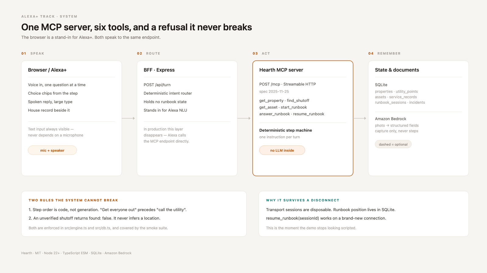

# Hearth

> **This repository contains a self-hosted MCP server (Streamable HTTP, spec 2025-11-25).**  
> **Entry point:** [`backend/src/index.ts`](backend/src/index.ts) · **Tool registration:** [`backend/src/server.ts`](backend/src/server.ts)  
> **Start:** `cd backend && npm ci && npm run seed && npm run build && npm start`

**Live demo:** <https://hearth-production-8551.up.railway.app>  
**Demo video (1:07):** <https://youtu.be/scuF6O7mVag>  
**Deploy:** Railway (Dockerfile, `/data` volume) · `railway up -d`

**The operating record of a house, exposed to Alexa+ as a self-hosted MCP server.**

Alexa knows how to turn off a water main. It doesn't know where yours is.

Hearth is a self-hosted MCP server that holds the house-specific facts a voice assistant needs in an emergency — where the shutoffs are, what the boiler is, when it was last serviced, what the dishwasher's warranty covers — and walks the user through a deterministic, resumable procedure one step at a time.

Track: **Alexa+** · Transport: **Streamable HTTP** · Protocol: **2025-11-25**

---

## Quick start

```bash
cd backend
npm ci
npm run seed      # demo property with a full record, plus an empty one for refusal tests
npm run build
npm start         # http://localhost:8787
```

The frontend is plain HTML in `frontend/` — no build step. The server serves it automatically.

Open **http://localhost:8787** in your browser to launch the Hearth voice UI.

In a second terminal:

```bash
npm run smoke     # end-to-end MCP checks
npm run eval      # 40-utterance intent benchmark + safety refusals + latency
```

Expected smoke output:

```
  PASS  exposes 7 tools
  PASS  property resolves
  PASS  verified shutoff is returned
  PASS  unverified shutoff is refused, not guessed
  PASS  runbook starts with one question
  PASS  advances to a single instruction
  PASS  resumes at the same step after a reconnect
  PASS  gas flow leads with evacuation
  PASS  drafts an insurance claim from incident

All checks passed.
```

Inspect the server with any MCP client:

```bash
npx @modelcontextprotocol/inspector
# transport: Streamable HTTP
# url: http://localhost:8787/mcp
```

---

## Benchmark Evaluation Results

Evaluated against `test/fixtures/utterances.json` spanning panic phrasings, unverified shutoffs, and drop/reconnect scenarios:

| Metric | Result | Target | Status |
|---|---|---|---|
| **Intent Accuracy** | **40/40 (100%)** | ≥ 90% | **PASS** |
| **Refusal Correctness** | **5/5 (100%)** | 100% | **PASS** |
| **Resume Correctness** | **3/3 (100%)** | 100% | **PASS** |
| **Median Latency (p50)** | **1 ms** | < 300 ms | **PASS** |
| **95th Percentile Latency (p95)** | **5 ms** | < 500 ms | **PASS** |

Full suite logs: [`docs/evaluation.md`](docs/evaluation.md).

---

## Why this exists

- **63 million** Americans provide ongoing care or household support for someone else (AARP, 2025).
- **75%** of adults 50+ want to remain in their home as they age (AARP, 2024).
- The national median assisted-living cost is **$6,200/month** (CareScout, 2025).

The common thread isn't frailty. It's **undocumented houses**. The shutoff is behind a panel nobody has opened. The warranty expired without anyone noticing. The plumber's number is in a text from 2023.

Voice is the right interface for this because the moment you need it, your hands are wet, the power is out, or you're standing in a basement with a flashlight.

---

## Architecture



| Layer | Responsibility |
|---|---|
| `src/index.ts` | Express, Streamable HTTP transport, session map, static UI, BFF |
| `src/server.ts` | MCP tool registration (7 tools) |
| `src/engine.ts` | Deterministic runbook state machine |
| `src/runbooks/*.ts` | Step data for water and gas |
| `src/db.ts` | SQLite schema and queries; `findVerifiedPoint()` is the refusal boundary |
| `src/api/turn.ts` | Turn handler & NLU routing layer |
| `src/api/capture.ts` | Appliance photo capture & nameplate extraction |
| `src/seed.ts` | Demo data (`prop_alder` with rich records, `prop_canyon` for safety refusals) |
| `public/index.html` | Voice-first browser UI (no framework, no build step) |

---

## Tools

| Tool | Input Schema | Output / Purpose |
|---|---|---|
| `get_property` | `{ propertyId: string }` | Address, year built, all recorded utility points with `verified` status |
| `find_shutoff` | `{ propertyId: string, utility: "water_main" \| "gas_meter" \| "electrical_panel" }` | Returns shutoff location. **Refuses (`found: false`) when unverified** |
| `get_asset` | `{ propertyId: string, query: string }` | Appliance/system lookup with warranty expiry and service records |
| `start_runbook` | `{ propertyId: string, emergencyType: "water" \| "gas" }` | Initiates deterministic emergency step machine. Persisted in SQLite |
| `answer_runbook` | `{ sessionId: string, answer: string }` | Advances one step based on user confirmation or choice |
| `resume_runbook` | `{ sessionId: string }` | Recovers the exact active step after a network drop or reconnect |
| `draft_claim` | `{ incidentId: string }` | Generates a chronological mitigation log with involved appliance warranties |

Full schemas and contracts: [`SPEC.md`](SPEC.md).

---

## Browser UI

The voice simulation UI at **http://localhost:8787** connects to the same `/mcp` Streamable HTTP endpoint that an Alexa+ agent uses. It is a single `public/index.html` file — no framework, no build step.

### Layout

```
┌─ Header ─────────────────────────────────────────────────────────────────┐
│  🏠 Hearth  [ALEXA+ MCP]  ● MCP live  ⚡ Xms  [1427 Alder St ▾]  Voice On │
└──────────────────────────────────────────────────────────────────────────┘
┌─ Left column ───────────────────────┬─ Right column ────────────────────┐
│  Hearth Assistant hero card         │  House Profile — 1427 Alder St    │
│  (status pill · answer · state)     │  Tabs: Shutoffs · Appliances ·    │
│                                     │        Service Log · Vision ·     │
│  Voice input card                   │        Insurance Claim            │
│  (mic button · quick scenarios)     │                                   │
│  (text input · Send)                │  Shutoff cards:                   │
│                                     │  Water Main · Gas Meter ·         │
│  Live Voice Transcript              │  Electrical Panel                 │
│  (session · message count · time)   │  each with VERIFIED ✓ (NN%) badge │
└─────────────────────────────────────┴───────────────────────────────────┘
```

### Voice & Input

- Web Speech API mic (`webkitSpeechRecognition`) with `speechSynthesis` output
- Text input fallback always visible — the demo never depends on a microphone permission dialog
- **Space bar** toggles voice input globally (ignored inside text fields, textareas, selects, and `contenteditable` elements)
- Single-line mic hint: *"Tap the mic or press Space"*
- Quick scenario chips with categorised demo prompts (drawer collapsed by default, state persisted in `localStorage`)

### Transcript & Session State

- Live transcript header: `Conversation · N messages · last activity hh:mm` when messages exist; *"No messages yet"* when empty — never *"No active session"*
- Telemetry row shows **Active runbook** (name or *"None"* when idle) driven by the central `sessionStore`
- Scroll-aware vertical fade masks on the transcript stream; first-message timestamp never clipped under the header divider

### House Record Panel

- Tabs with count badges and Lucide icons (Shutoffs tab uses `Power` icon)
- Tab scroll arrows appear only on overflow (< 1100 px) and are disabled at scroll boundaries
- Right column sticky-scrolls alongside the voice transcript
- Shutoff cards display:
  - **Location hint** (MapPin icon) — exact physical placement
  - **Operating instruction** (Wrench icon, amber tint) — *"How to shut off"*
  - **Critical callout** (AlertTriangle, red tint) — triggered when text contains *Warning / Danger / Never / Do not*
  - `VERIFIED ✓ (NN%)` confidence badge
  - 48 px photo thumbnail with click-to-open lightbox, or a ghost *"Add photo"* button when no photo exists

### Hero Answer Card

- Structured answer display with distinct voice / runbook / info styling
- *Show on profile* (MapPin icon) visible only when the answer maps to a physical house component
- *Ask another question* shifts focus directly to the mic / input field
- Per-tab error boundaries and meaningful empty states

### Emergency Mode

Triggered by the *Gas Odor Alert* and *Water Under Sink* demo scenarios:

- Solid red accent bar across the top of the hero card
- Status pill changes to bold red **EMERGENCY**
- Numbered step checklist: current step highlighted, completed steps struck-through
- `aria-live="assertive"` announcements for screen readers
- Persistent action button: *Call 911 / Gas Utility* (gas) or *Call Emergency Plumber* (water)
- *Stop runbook* secondary action cleans up state and returns to idle

### Accessibility & Polish

- WCAG AA contrast on all text and badge combinations
- `:focus-visible` rings on all interactive elements (buttons, tabs, chips, inputs)
- Semantic `aria-label` attributes on buttons and landmark regions
- No background bleed: `html, body { margin: 0; background-color: var(--bg); }`

---

## The two design rules

**1. Statistics and state machines decide; language models explain.**  
No LLM sits inside the runbook step machine. Step order is a safety property — "get everyone out of the house" must come before "call the utility", every time, deterministically. The only place a model belongs is extraction: turning a photo of a nameplate into structured fields. That path is scaffolded for Amazon Bedrock but currently returns deterministic mock data — no AWS call is made in the deployed demo.

**2. Never guess a shutoff.**  
`find_shutoff` returns `found: false` when a location hasn't been verified for that specific house. The refusal is the product: an assistant that invents a valve location is worse than no assistant.

---

## What is mocked

- **Authentication:** Absent in demo mode; production uses OAuth 2.1 + PKCE as an MCP resource server.
- **Bedrock Vision:** not implemented. The capture endpoint returns deterministic nameplate fields. `CAPTURE_MODE` is read but no AWS SDK is wired, which is why this project does **not** enter the AWS Builder mini challenge.
- **NLU / Voice Simulation:** The browser UI at `http://localhost:8787` stands in for Alexa+; it speaks to the exact same `/mcp` Streamable HTTP endpoint an Alexa+ agent uses.
- **Runbook catalog:** Two emergency runbooks are implemented (water, gas). The engine DSL cleanly supports electrical, HVAC, and freeze warnings.

---

## What's next

- OAuth 2.1 resource server integration for Alexa+ skill account linking
- Realtor / home-inspection onboarding workflow (the cold-start solution)
- Additional runbooks: electrical panel isolation, HVAC freeze prevention, lockout recovery
- Direct claim export to major homeowner insurance carriers (JSON-LD schema)
- Local on-device document extraction via WebAssembly
- Push notifications for warranty expiry and upcoming service dates

---

## Development

All commands run from `backend/`:

```bash
cd backend
npm run dev     # tsx watch
npm run build   # tsc
npm run smoke   # end-to-end MCP checks (7 tools)
npm run eval    # 40-utterance intent & safety evaluation
```

See [`BUILD-PLAN.md`](BUILD-PLAN.md) for schedule and [`SPEC.md`](SPEC.md) for contracts.  
See [`docs/friction-log.md`](docs/friction-log.md) for developer experience notes.

MIT licensed.
